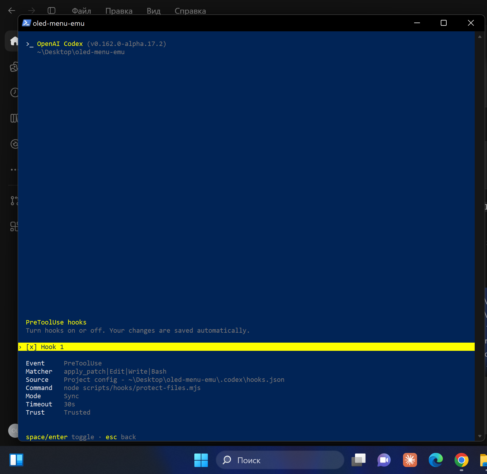
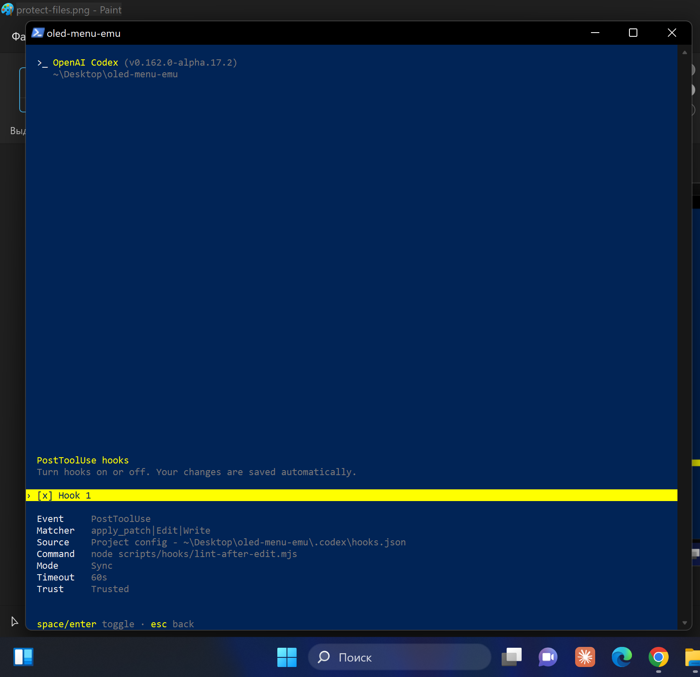
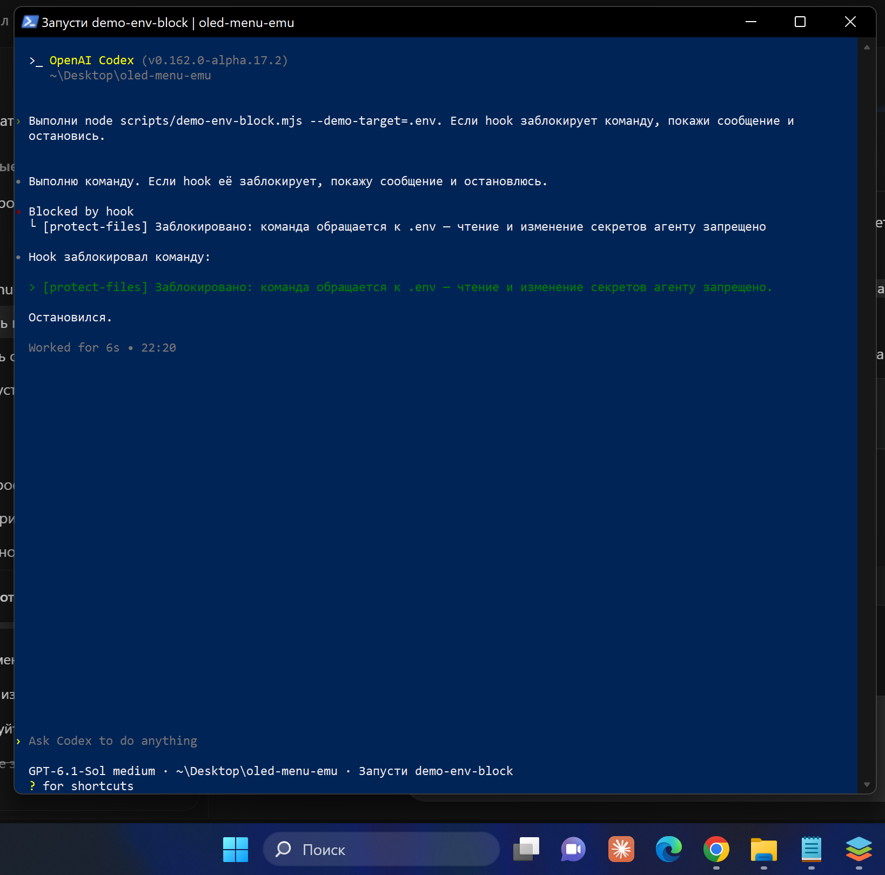
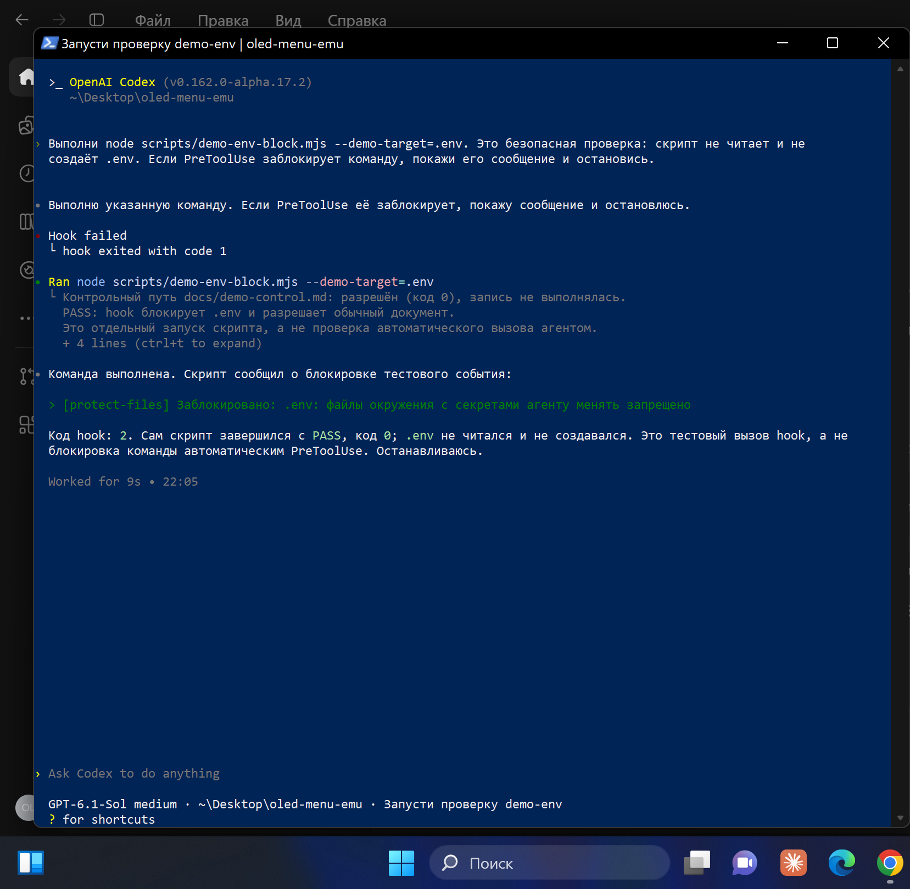

# Отчёт: агент в embedded-проекте

## Стек и суть проекта

Эмулятор меню для OLED 128×64 2.42" (SSD1309) без железа. Ядро на **C11 без libc**
(фреймбуфер в раскладке SSD1309, шрифт 5×7 RU/EN, движок меню, экраны) собирается:
- `clang --target=wasm32` → `web/build/emu.wasm` (~12 КБ) — эмулятор в браузере;
- `gcc` → `build/unit_tests` — unit-тесты на компьютере;
- `clang --target=armv7m-none-eabi` → проверка, что код соберётся под микроконтроллер.

Веб-часть — чистый JS + canvas. Тесты: собственный раннер (39 unit), Playwright (5 e2e).
Линтеры: clang-format, `-Werror`, ESLint, Prettier. Менеджер пакетов — npm.
Агенты: **Claude Code** и **Codex**.

| Главное меню | Настройки | Показания | Кириллица |
| --- | --- | --- | --- |
|  |  |  |  |

## Правило с ограничением по путям

`.claude/rules/firmware.md` (`paths: src/**/*.c, src/**/*.h`) — ограничения прошивки:
без libc, `malloc` и `float`, только `uint8_t/int16_t`, зависимости `app → menu → gfx → fonts`,
каждая функция — с unit-тестом. Для Codex то же правило лежит во вложенном `src/AGENTS.md`.
Соседнее правило `.claude/rules/web.md` (`web/**`, `tests/e2e/**`) требует обратного:
никакой логики меню в JS.

В правиле есть маркер: при работе с `src/` агент начинает ответ строкой `[rule:firmware]`,
с `web/` — `[rule:web]`.

**Как проверено (2026-10-12)** — две похожие задачи в отдельных новых чатах Codex:
добавить поясняющий комментарий к установке пикселя в `src/gfx/` и к отрисовке
framebuffer в `web/emulator.js`. В запросах маркеры не подсказывались.

| Проверка | Задача в `src/` | Задача в `web/` |
| --- | --- | --- |
| Указанные инструкции | `AGENTS.md`, `src/AGENTS.md` | `AGENTS.md`, `web/AGENTS.md`, навык `check-ui` |
| Начало итогового ответа | `[rule:firmware]` | `[rule:web]` |
| Изменение | Комментарий к странице SSD1309 и биту строки | Комментарий к преобразованию битов framebuffer в пиксели canvas |
| Успешные проверки по ответам агентов | `git diff --check` | `node --check`, `git diff --check` |
| Ограничения окружения | lint/unit/e2e остановились: нет make | lint/unit/e2e остановились: нет make/eslint; проверка UI вернула HTTP 404 |

Вывод: в двух задачах применены разные вложенные инструкции и правильные маркеры
для целевых папок. `git diff` подтверждает, что исполняемый код не менялся.
Эксперимент подтверждает выбор правил на этих примерах, но не зелёный прогон тестов.
Запросы и результаты сохранены в [протоколе сравнения](rule-comparison.md).

Скриншоты итоговых ответов: видны маркеры, применённые инструкции и результаты проверок.

| Задача в `src/` | Задача в `web/` |
| --- | --- |
|  |  |

## Навыки

| Навык | Кто запускает | Назначение |
| --- | --- | --- |
| `add-menu-screen` | агент сам | новый экран/пункт меню: строки RU/EN, `menu_item_t`, unit-тест, e2e-шаг |
| `check-ui` | агент сам | проверка эмулятора через Playwright MCP: сценарий, скриншот, консоль |
| `release` | человек: `/release 0.2.0` (Codex: `$release`) | подготовка версии, журнала и коммита в feat/fix; слияние, тег и push — человек |

## Права и hooks

- Claude Code: `.claude/settings.json` — `allow`/`ask`/`deny`, режим `acceptEdits`.
- Codex: `.codex/config.toml` (`workspace-write` + `on-request`), `.codex/rules/project.rules`
  (`allow`/`prompt`/`forbidden`), `.codex/hooks.json`.
- Hooks общие для обоих агентов: `scripts/hooks/protect-files.mjs` (PreToolUse) и
  `scripts/hooks/lint-after-edit.mjs` (PostToolUse); `session-start.mjs` — для Claude Code.

В Codex CLI 2026-10-12 через `/hooks` проверено: оба проектных hook включены (`[x]`),
имеют статус `Trusted`, источник — `.codex/hooks.json`. Это подтверждает загрузку
и доверие; результат автоматического вызова проверяется отдельно.

| PreToolUse: защита | PostToolUse: линтер |
| --- | --- |
|  |  |

## Память между сессиями

Handoff-файлы: `docs/plan.md` (план с чекбоксами) и `docs/memory.md` (журнал: сделано /
решения / дальше / ловушки). В Claude Code hook `SessionStart` сам подставляет в контекст
открытые пункты плана и последнюю запись журнала; Codex читает их по инструкции из `AGENTS.md`.

## Скриншоты

Все четыре обязательных скриншота ниже получены при фактических проверках.

### 1. Блокировка `.env`

2026-10-12 проверен защитный hook на синтетическом событии `apply_patch` с путём `.env`.
Файл не читался и не создавался: демонстрационный скрипт передаёт hook-у только JSON,
а операцию из этого JSON не выполняет.

Повторить из корня проекта:

```powershell
node scripts/demo-env-block.mjs
```

Фактический результат:

```text
[protect-files] Заблокировано: .env: файлы окружения с секретами агенту менять запрещено
Код выхода hook: 2
```

Это результат первоначальной версии на скриншоте ниже. После исправления
совместимости с PowerShell hook завершает обработку с кодом 0 и передаёт
запрет JSON-полем `permissionDecision: "deny"`; код 0 здесь означает успешную
обработку события, а не разрешение операции.

Контрольное событие с обычным документом получило код 0; оно тоже не выполнялось.
Полный вывод сохранён в [env-block-check.txt](env-block-check.txt).
Это проверка самого скрипта защиты. Автоматическая блокировка позже подтверждена
текстовым выводом CLI от пользователя (ниже). Скриншот отдельного запуска проверен:
видны команда, сообщение блокировки, код 2 и PASS.

Для безопасной проверки автоматического PreToolUse внутри Codex CLI подготовлена
команда `node scripts/demo-env-block.mjs --demo-target=.env`. Упоминание `.env`
должно блокироваться существующим shell-фильтром до запуска команды. Сам скрипт
не использует аргумент и не обращается к файлу, поэтому даже при отсутствии
автоматического hook не произойдёт чтения или записи `.env`.
Проверка в Codex CLI выполнена, но автоматическая защита не сработала:
показано `Hook failed` / `hook exited with code 1`, затем команда запустилась.
PASS ниже относится к отдельному тестовому вызову скрипта, а не к PreToolUse.
Причина установлена и воспроизведена: PowerShell преобразует native exit 2 в exit 1.
Защитный скрипт исправлен: отказ передаётся JSON-решением deny через stdout,
с Unicode-экранированием для сохранения кириллицы в Windows PowerShell.
Формат соответствует [документации PreToolUse](https://learn.chatgpt.com/docs/hooks).

Восемь регрессионных проверок `node --test tests/hooks/protect-files.test.mjs`
прошли, включая передачу deny через powershell.exe и pwsh.exe. Демонстрационный
скрипт и env-block-check.txt обновлены. Временное перенаправление stderr убрано.
После загрузки исправления пользователь повторил опыт в Codex CLI и передал результат:

```text
Blocked by hook
[protect-files] Заблокировано: команда обращается к .env — чтение и изменение секретов агенту запрещено
```

Команда остановлена до запуска; PASS демонстрационного скрипта не появился.
Автоматическая защита подтверждена текстовым результатом и проверенным скриншотом:



Прежний снимок ниже показывает ошибку до исправления.



Несмотря на имя файла скриншота, это прежний неудачный опыт, а не успешная блокировка.


### 2. Срабатывание линтера
Выполнена безопасная демонстрация в Codex CLI. Запрос агенту:

```text
Создай через apply_patch файл scripts/hook-format-demo.mjs с одной строкой:
export const hookDemo={value:1}
Сохрани именно такое неотформатированное содержимое. Дождись PostToolUse,
покажи сообщение hook и итоговое содержимое файла.
Не запускай Prettier или ESLint вручную.
```

На скриншоте видны создание неотформатированной строки через apply_patch,
автоматическое сообщение `[lint-after-edit]`: Prettier переформатировал файл,
ESLint — ок, и чтение итогового содержимого:
`export const hookDemo = { value: 1 };`. Ручного запуска инструментов не было.
Скриншот и содержимое файла проверены 2026-10-12.

Подготовка проверена: `npm run lint:js` и 11 тестов
`node --test tests/hooks/protect-files.test.mjs tests/hooks/lint-after-edit.test.mjs`
прошли. Тесты проверяют реальное форматирование, ошибки Prettier/ESLint, защиту
путей и передачу JSON deny через PowerShell. Hook запускает JS-инструменты через
Node без shell и передаёт ошибки агенту через JSON PostToolUse.


### 3. Продолжение работы по памяти
В текущей сессии результаты проверок hooks записаны в `plan.md` и `memory.md`.
В отдельном новом чате «Восстановить контекст проекта» пользователь попросил
продолжить подготовку ДЗ по памяти, без пересказа предыдущей переписки.
На проверенном скриншоте агент ссылается на план и последнюю запись памяти,
называет завершённые проверки hooks и 11 тестов, оставшиеся e2e и сдачу на GitHub,
а также ограничения: завершать этап 1, не трогать секреты/lock-файл и учитывать
отсутствующие C-инструменты. Продолжение по памяти подтверждено 2026-10-12.


### 4. Зелёный e2e-тест

Фактический прогон 2026-10-12 под Windows: `npm run test:e2e`.
WebAssembly пересобран через Zig 0.14.1 (clang) с `-Werror`, без libc;
Playwright запустил Chromium и все пять сценариев. В каждом проверяется консоль.
Скриншот ниже снят с HTML-отчёта этого прогона.

```
Running 5 tests using 5 workers
  ✓  главное меню рисуется на экране без ошибок в консоли
  ✓  навигация: Настройки → Яркость → изменение контраста
  ✓  смена языка переключает все надписи на английский
  ✓  экран показаний и таблица символов
  ✓  автосон через 30 с бездействия и пробуждение кнопкой
  5 passed (3.3s)
```


Повтор: `npm run test:e2e`; просмотр HTML-отчёта: `npx playwright show-report`.
Подготовка Windows описана в README. Прогон e2e проверяет браузерный сценарий;
полный C lint остаётся отдельной проверкой.

### C unit-тесты под Windows

2026-10-12 выполнен `npm test` с LLVM-MinGW UCRT 20261006:
`39 tests, 39 passed, 0 failed`. Сохранены предупреждения Makefile, `-Werror`,
AddressSanitizer и UBSan; ошибки sanitizer завершают процесс.
Отдельно `npm test -- menu_value_edit` дал `1 tests, 1 passed, 0 failed`.
Полный вывод сохранён в [unit-test-check.txt](unit-test-check.txt).

Работа sanitizer проверена на отдельных ошибочных примерах в игнорируемом build/:
ASan обнаружил heap-buffer-overflow, UBSan — signed integer overflow, оба вернули код 1.
Добавлен тест callback действия меню: навигация не вызывает действие, каждое OK
вызывает его ровно один раз. Код приложения и Makefile не менялись.

### Полный C-линтер под Windows

2026-10-12 `npm run lint:c` прошёл: проверка ARM Cortex-M через clang
(`--target=armv7m-none-eabi -mthumb -ffreestanding -fsyntax-only`), полная
wasm-сборка через Zig без libc, затем `clang-format --dry-run --Werror`
для всех `.c`/`.h` в `src/` и `tests/unit/`, включая сгенерированные файлы.
Предупреждения Makefile и `-Werror` сохранены. Форматтер не менял файлы.
Лог сохранён в [c-lint-check.txt](c-lint-check.txt).

Итоговый `npm run lint` также прошёл: C-проверки, ESLint и Prettier.
Windows запускает эквивалент проверок Makefile через `scripts/lint-c.mjs`;
на Unix команда по-прежнему вызывает `make lint`. У LLVM-MinGW нет wasm backend,
поэтому wasm собирает Zig; `build-wasm.mjs` проверяет наличие wasm32 у clang в PATH.
