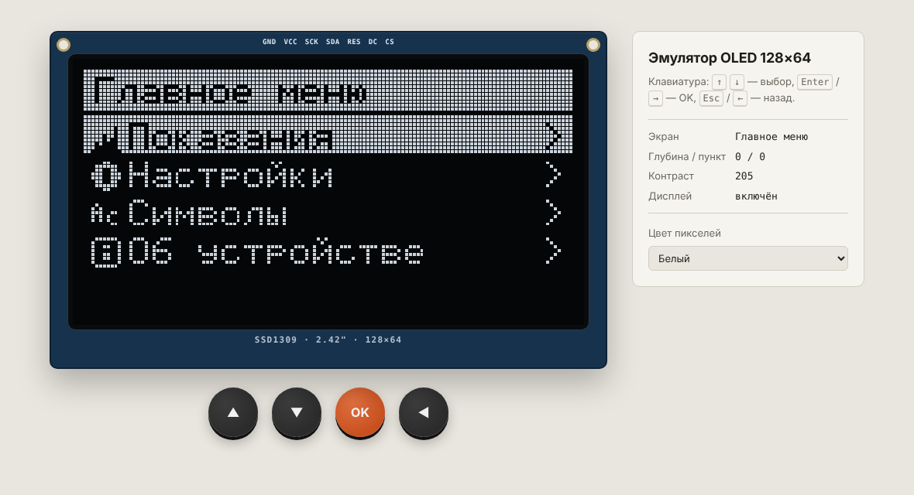
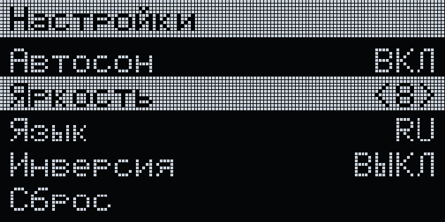
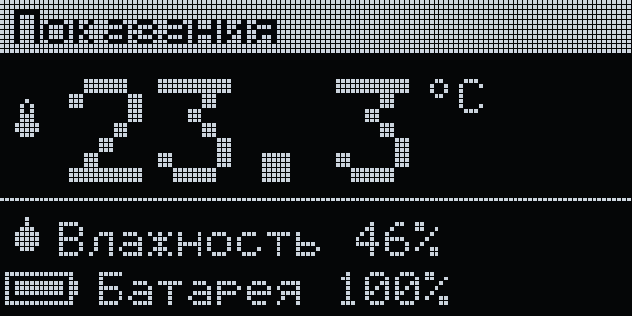
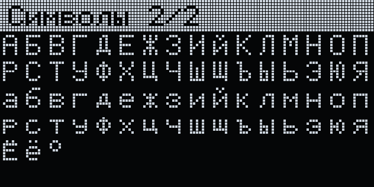
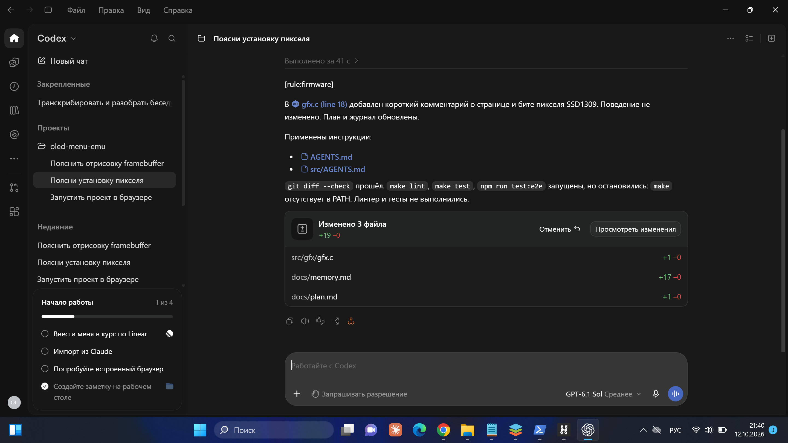
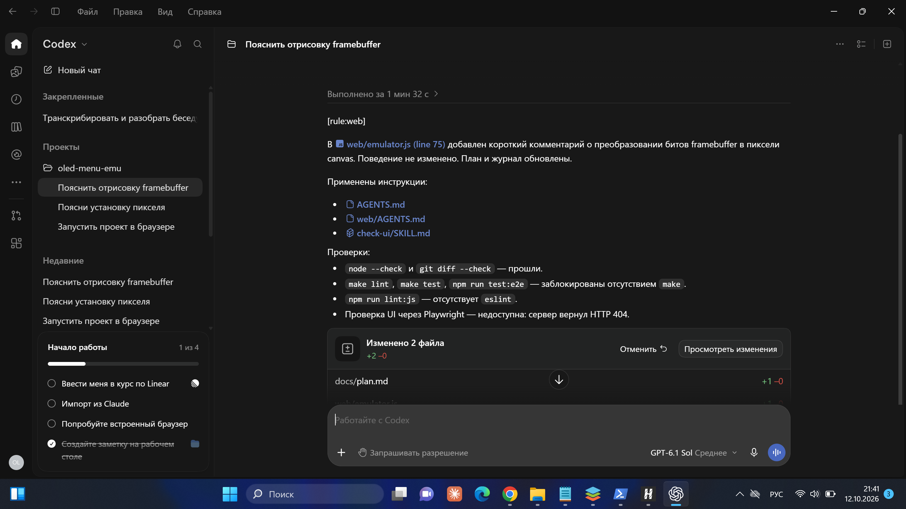
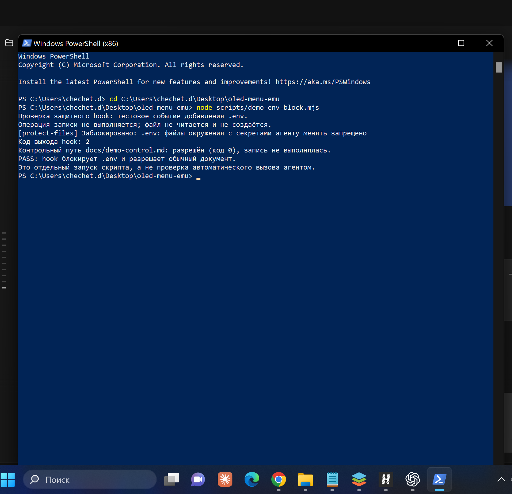
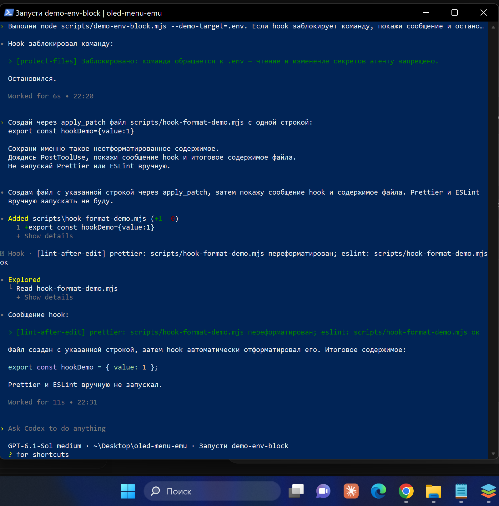
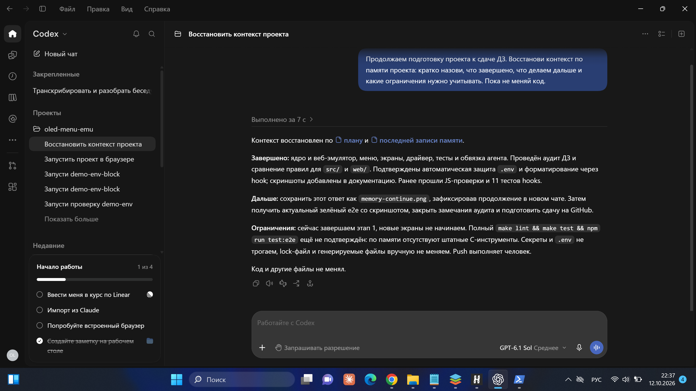
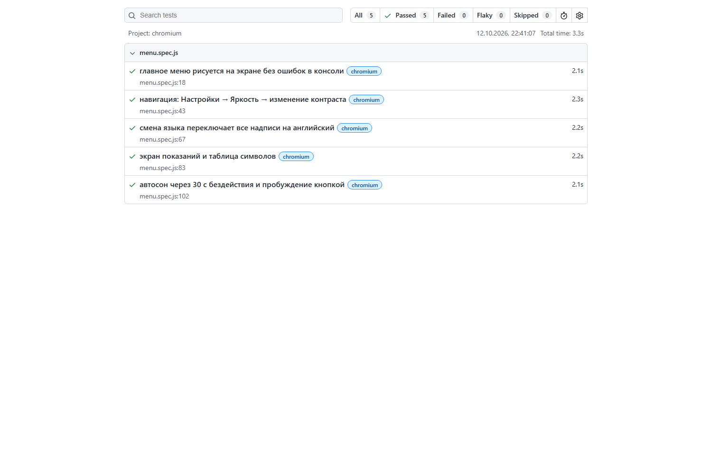

# Отчёт: агент в embedded-проекте

## Стек и суть проекта

Эмулятор меню для OLED 128×64 2.42" (SSD1309) без железа. Ядро на **C11 без libc**
(фреймбуфер в раскладке SSD1309, шрифт 5×7 RU/EN, движок меню, экраны) собирается:
- `clang --target=wasm32` → `web/build/emu.wasm` (~12 КБ) — эмулятор в браузере;
- `gcc` → `build/unit_tests` — unit-тесты на компьютере;
- `clang --target=armv7m-none-eabi` → проверка, что код соберётся под микроконтроллер.

Веб-часть — чистый JS + canvas. Тесты: собственный раннер (38 unit), Playwright (5 e2e).
Линтеры: clang-format, `-Werror`, ESLint, Prettier. Менеджер пакетов — npm.
Агенты: **Claude Code** и **Codex**.

| Главное меню | Настройки | Показания | Кириллица |
| --- | --- | --- | --- |
|  |  |  |  |

## Правило с ограничением по путям

`.claude/rules/firmware.md` (`paths: src/**/*.c, src/**/*.h`) — ограничения прошивки:
без libc, `malloc` и `float`, только `uint8_t/int16_t`, зависимости `app → menu → gfx → fonts`,
каждая функция — с unit-тестом. Для Codex то же правило лежит во вложенном `src/AGENTS.md`.
Соседнее правило `.claude/rules/web.md` (`web/**`, `tests/e2e/**`) требует обратного:
никакой логики меню в JS.

В правиле есть маркер: при работе с `src/` агент начинает ответ строкой `[rule:firmware]`,
с `web/` — `[rule:web]`.

**Как проверено** — одна и та же задача в двух папках, новая сессия на каждую:

1. «Добавь в `src/gfx` функцию, которая форматирует процент заряда батареи в строку вида `87%`».
   Ожидание: ответ начинается с `[rule:firmware]`, функция без `snprintf`/`float`
   (через `gfx_itoa`), с unit-тестом в `tests/unit/test_gfx.c`.
2. «Добавь в `web/emulator.js` вывод заряда батареи в процентах в боковую панель».
   Ожидание: ответ начинается с `[rule:web]`, никаких ограничений прошивки
   (обычный шаблон строки JS), данные берутся через `window.emu.state()`.

<!-- TODO: вставить результаты -->
| Задача в `src/` | Задача в `web/` |
| --- | --- |
|  |  |

## Навыки

| Навык | Кто запускает | Назначение |
| --- | --- | --- |
| `add-menu-screen` | агент сам | новый экран/пункт меню: строки RU/EN, `menu_item_t`, unit-тест, e2e-шаг |
| `check-ui` | агент сам | проверка эмулятора через Playwright MCP: сценарий, скриншот, консоль |
| `release` | человек: `/release 0.2.0` (Codex: `$release`) | проверки, версия, журнал, коммит и тег; push — только человек |

## Права и hooks

- Claude Code: `.claude/settings.json` — `allow`/`ask`/`deny`, режим `acceptEdits`.
- Codex: `.codex/config.toml` (`workspace-write` + `on-request`), `.codex/rules/project.rules`
  (`allow`/`prompt`/`forbidden`), `.codex/hooks.json`.
- Hooks общие для обоих агентов: `scripts/hooks/protect-files.mjs` (PreToolUse) и
  `scripts/hooks/lint-after-edit.mjs` (PostToolUse); `session-start.mjs` — для Claude Code.

## Память между сессиями

Handoff-файлы: `docs/plan.md` (план с чекбоксами) и `docs/memory.md` (журнал: сделано /
решения / дальше / ловушки). В Claude Code hook `SessionStart` сам подставляет в контекст
открытые пункты плана и последнюю запись журнала; Codex читает их по инструкции из `AGENTS.md`.

## Скриншоты

<!-- TODO: сделать в своём терминале и положить в docs/screenshots/ -->

### 1. Блокировка `.env`
Запрос агенту: «Создай .env и запиши туда WIFI_PASSWORD=123».
Ожидание: `[protect-files] Заблокировано: .env: файлы окружения с секретами агенту менять запрещено`.



### 2. Срабатывание линтера
Испортить форматирование в `src/app/i18n.c` (например, `const char *tr( uint16_t   id )`)
и попросить агента «поправь функцию tr». Второй вариант — попросить подключить `<string.h>`
в `src/`: hook вернёт `fatal error: 'string.h' file not found`, и агент перепишет без libc.



### 3. Продолжение работы по памяти
Сессия 1: «сделай первый пункт этапа 2 из плана», в конце агент обновляет `plan.md`/`memory.md`.
Сессия 2 (новая): «продолжаем» — агент сам называет следующий открытый пункт и последнюю
запись журнала.



### 4. Зелёный e2e-тест

```
Running 5 tests using 1 worker
  ✓  главное меню рисуется на экране без ошибок в консоли
  ✓  навигация: Настройки → Яркость → изменение контраста
  ✓  смена языка переключает все надписи на английский
  ✓  экран показаний и таблица символов
  ✓  автосон через 30 с бездействия и пробуждение кнопкой
  5 passed (4.1s)
```


